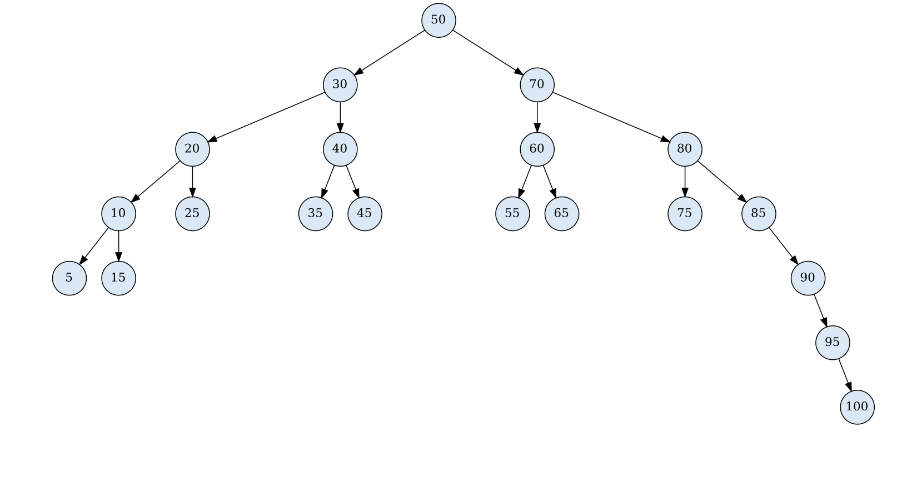
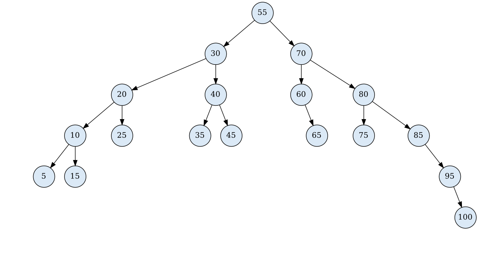
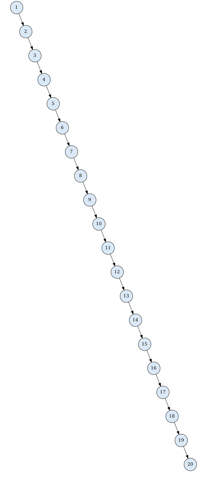
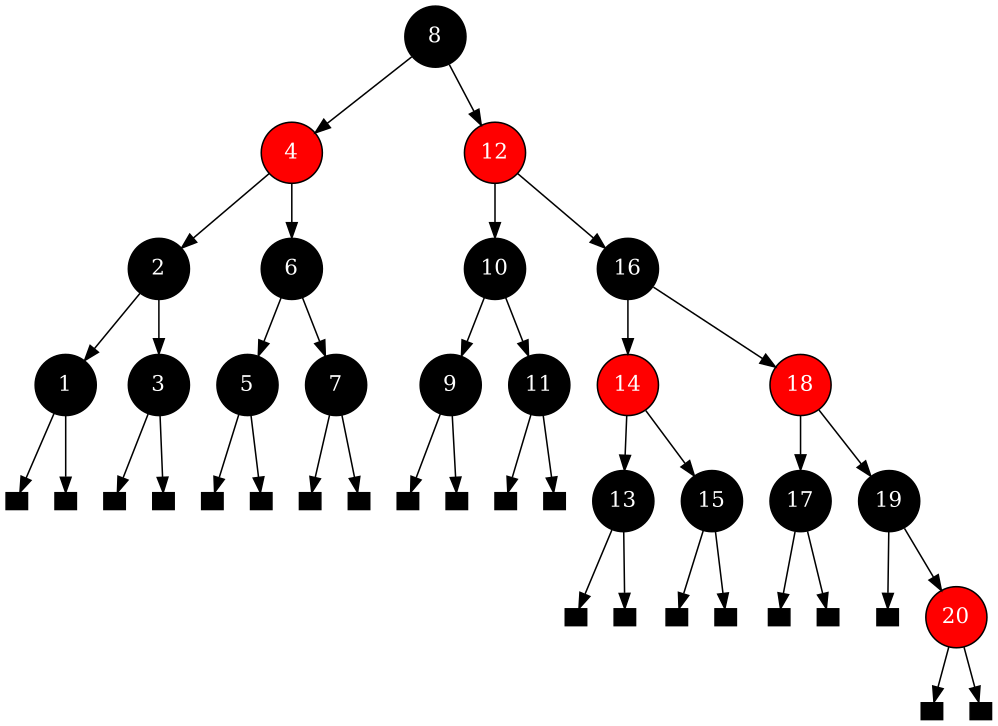

# Tarea #6 — Árboles y Grafos (Programación III, CS2013, 2026-2)

Implementación en C++17 de:

| Problema | Archivo | Contenido |
|---|---|---|
| 1 | `include/BST.h` | BST con inserción y eliminación **iterativas**, in-order con `std::stack`, altura, verificación AVL |
| 2 | `include/RedBlackTree.h` | Red-Black Tree: rotaciones, recoloración, `insertFixup`, verificación formal de propiedades, altura |
| 3 | `include/TreeAlgorithms.h` → `algo::pathWithSum` | DFS iterativo (solo `std::stack`): camino raíz-hoja con suma K |
| 4 | `include/TreeAlgorithms.h` → `algo::isComplete`, `algo::maxWidth`, `algo::minDepth` | BFS iterativo (solo `std::queue`) |
| — | `include/BinaryTree.h` | Árbol binario genérico construido por niveles (para los problemas 3 y 4) |
| — | `src/main.cpp` | Función principal que prueba todo y hace la comparación experimental |

Ninguna de las operaciones pedidas usa recursión.

## Cómo compilar y ejecutar

```bash
# Con CMake
mkdir build && cd build
cmake .. && make
./tarea6

# O directamente con g++
g++ -std=c++17 -Wall -Wextra -O2 -Iinclude src/main.cpp -o tarea6
./tarea6
```

El programa imprime los resultados de los 4 problemas y genera archivos `.dot` en `graficos/`. Para convertirlos en imágenes: `dot -Tpng graficos/p2_rbt_ordenado.dot -o rbt.png` (Graphviz). La salida completa del programa está en [`salida.txt`](salida.txt).

Convención: **altura = número de niveles** (nodos en el camino raíz-hoja más largo). Árbol vacío → 0, un nodo → 1. La altura en aristas es este valor menos 1.

---

## Problema 1: BST iterativo y análisis de degradación

### Implementación

- **Inserción** (`insert`): se desciende con un puntero `cur` guardando el `parent`; al llegar a `nullptr` se cuelga el nodo nuevo del padre. O(h).
- **Eliminación** (`remove`): se busca el nodo y su padre de forma iterativa.
  - 0 o 1 hijo: el padre apunta directamente al único hijo (o a `nullptr`).
  - 2 hijos: se busca el sucesor in-order (mínimo del subárbol derecho), se copia su clave y se elimina el sucesor, que tiene a lo más un hijo derecho → se reduce al caso anterior. O(h).
- **In-order** con `std::stack`: se apila bajando por la izquierda; al no poder bajar se desapila, se visita y se pasa al hijo derecho. O(n) tiempo, O(h) memoria.
- **Altura**: recorrido por niveles contando niveles. O(n).

### Prueba (20 inserciones, 2 eliminaciones)

```
Insertados (20): 50 30 70 20 40 60 80 10 25 35 45 55 65 75 85 5 15 90 95 100
Altura   : 7

Eliminar 50 (raiz, 2 hijos -> se reemplaza por su sucesor 55): OK
Eliminar 90 (1 hijo -> se puentea con 95): OK

In-order (std::stack) : 5 10 15 20 25 30 35 40 45 55 60 65 70 75 80 85 95 100
Tamano                : 18
Altura (niveles)      : 6
```

| Antes de eliminar | Después de eliminar 50 y 90 |
|---|---|
|  |  |

### ¿Por qué la complejidad se degrada a O(n)? (demostración)

**Costo de una operación.** Insertar, buscar o eliminar la clave x recorre exactamente los nodos del camino desde la raíz hasta x (o hasta la posición donde x se insertaría), haciendo una comparación por nodo. Por tanto el costo es Θ(profundidad), y en el peor caso Θ(h), con h la altura.

**Cotas de la altura.** El nivel i de un árbol binario tiene a lo más 2^(i−1) nodos, así que un árbol de altura h tiene n ≤ 2^h − 1 nodos, es decir h ≥ ⌈log₂(n+1)⌉. Además h ≤ n porque cada nivel tiene al menos un nodo. Un BST solo garantiza **⌈log₂(n+1)⌉ ≤ h ≤ n**: nada en sus reglas obliga a que h se mantenga cerca de la cota inferior.

**Proposición.** Si se insertan a₁ < a₂ < … < aₙ en ese orden en un BST vacío, el árbol resultante Tₙ es una cadena donde cada a_{i+1} es hijo derecho de a_i. Su altura es exactamente n.

*Demostración (inducción sobre k).*
- Base k = 1: T₁ es un solo nodo a₁ (altura 1).
- Paso: supongamos que T_k es la cadena a₁ → a₂ → … → a_k (todos hijos derechos). Al insertar a_{k+1}, en cada nodo a_j (j ≤ k) se cumple a_{k+1} > a_j, así que el algoritmo siempre va a la derecha. Recorre a₁, …, a_k (k comparaciones) y coloca a_{k+1} como hijo derecho de a_k. Entonces T_{k+1} es la cadena de longitud k+1. ∎

**Costo total.** La inserción número (k+1) cuesta k comparaciones, así que

  C(n) = Σ_{k=0}^{n−1} k = n(n−1)/2 ∈ Θ(n²),

lo que da un costo **amortizado de Θ(n) por operación**. Una vez construida la cadena, buscar o eliminar aₙ cuesta n comparaciones. Como h = n, y n no es O(log n) (porque lim n / log n = ∞), las operaciones pasan de O(log n) a **Θ(n)**.

**Verificación experimental:** al insertar 1..20 el programa mide altura = 20 y 190 comparaciones = 20·19/2. ✔

**Nota.** No solo el orden ascendente degrada el árbol. Hay exactamente 2^(n−1) órdenes de inserción que producen una cadena, porque en cada paso se puede insertar el mínimo o el máximo de lo que queda, y en todos ellos h = n.

---

## Problema 2: Red-Black Tree

### Implementación

- `rotateLeft` / `rotateRight`: O(1). Actualizan los punteros `parent` y la raíz, y conservan el orden in-order (a, x, b, y, c).
- `insert`: inserción normal de BST; el nodo nuevo nace **rojo**. Luego se llama a `insertFixup`.
- `insertFixup`: la única regla que se puede romper es la P3 (z y su padre rojos) o la P2 (z es la raíz). Con p = padre, g = abuelo, u = tío:
  - **Caso 1, tío rojo → recoloración:** p y u pasan a negro, g a rojo, y se sube z = g. La altura negra no cambia porque los caminos que pasan por g pierden un negro (g) y ganan uno (p o u).
  - **Caso 2, tío negro y forma de triángulo:** se rota en p y queda el caso 3.
  - **Caso 3, tío negro y forma de línea:** p pasa a negro, g a rojo y se rota en g. El ciclo termina.
  - Se hacen también los tres casos simétricos y al final la raíz se pinta de negro.
- `verify()`: verificación formal **iterativa**. Revisa P2 (raíz negra), P3 (ningún rojo con hijo rojo) y P4 (igual cantidad de negros en todo camino raíz → NIL), además del orden BST (con rangos mín/máx) y la consistencia de los punteros `parent`. P1 se cumple por el tipo `enum Color` y P5 porque `nullptr` cuenta como negro. Basta revisar P4 desde la raíz: dos caminos que parten de un nodo x comparten el prefijo raíz → x, así que si todos los caminos desde la raíz tienen la misma cantidad de negros, también la tienen los que parten de x.
- `height()`: por niveles. `preorderString()`: pre-orden con color, `(N)` para negro y `(R)` para rojo.

### Resultados: 20 elementos en orden ascendente

```
Propiedades verificadas tras cada insercion: TODAS OK
  P2 raiz negra : OK | P3 sin rojo-rojo : OK | P4 misma altura negra : OK (bh = 3)
  Rotaciones = 14, recoloraciones = 26

Comparacion de alturas (mismos datos 1..20):
  BST (Problema 1) : 20
  Red-Black Tree   : 6
  Cota 2*log2(n+1) : 8.78
  Minimo posible ceil(log2(n+1)) : 5

Pre-orden BST : 1 2 3 4 5 6 7 8 9 10 11 12 13 14 15 16 17 18 19 20
Pre-orden RBT : 8(N) 4(R) 2(N) 1(N) 3(N) 6(N) 5(N) 7(N) 12(R) 10(N) 9(N) 11(N) 16(N) 14(R) 13(N) 15(N) 18(R) 17(N) 19(N) 20(R)
```

| BST con 1..20 (altura 20) | Red-Black Tree con 1..20 (altura 6) |
|---|---|
|  |  |

(En el gráfico del RBT, los cuadrados negros son las hojas NIL.)

### Comparación experimental (semilla fija `mt19937(42)` para el orden aleatorio)

| n | BST ordenado | RBT ordenado | BST aleatorio | RBT aleatorio | 2·log₂(n+1) | comparaciones BST ord. | comparaciones RBT ord. |
|---|---|---|---|---|---|---|---|
| 20 | 20 | 6 | 9 | 6 | 8.78 | 190 | 83 |
| 100 | 100 | 11 | 13 | 9 | 13.32 | 4 950 | 809 |
| 1 000 | 1 000 | 17 | 23 | 12 | 19.93 | 499 500 | 14 481 |
| 10 000 | 10 000 | 24 | 32 | 16 | 26.58 | 49 995 000 | 211 383 |
| 20 000 | 20 000 | 26 | 31 | 17 | 28.58 | 199 990 000 | 462 715 |

Con datos ordenados, la altura del BST crece linealmente y sus comparaciones como n²/2. En el RBT la altura nunca supera 2·log₂(n+1) y las comparaciones crecen como n·log n. Con n = 20 000, el BST hace unas **430 veces más comparaciones**. Incluso con datos aleatorios, donde la altura esperada del BST es O(log n), el RBT queda más bajo.

### ¿Por qué la altura está acotada por O(log n)? (demostración)

**Definición.** La *altura negra* bh(x) es la cantidad de nodos negros en cualquier camino desde x (sin contar x) hasta una hoja NIL. Por la P4, este número no depende del camino elegido.

**Lema 1.** El subárbol con raíz x contiene al menos 2^{bh(x)} − 1 nodos internos.

*Demostración (inducción sobre la altura de x).*
- Si x es NIL, bh(x) = 0 y el subárbol tiene 0 = 2⁰ − 1 nodos internos. ✔
- Si x es interno, cada hijo c cumple bh(c) ≥ bh(x) − 1: vale bh(x) si c es rojo y bh(x) − 1 si c es negro. Por hipótesis inductiva, cada hijo tiene al menos 2^{bh(x)−1} − 1 nodos internos. Entonces
  n(x) ≥ 2·(2^{bh(x)−1} − 1) + 1 = 2^{bh(x)} − 1. ∎

**Lema 2.** Si h es la altura del árbol (cantidad de nodos internos en el camino raíz → NIL más largo, que es lo que mide `height()`), entonces bh(raíz) ≥ h/2.

*Demostración.* Tomemos un camino raíz → NIL de longitud máxima. Sin contar la raíz, tiene h nodos: h − 1 internos más la hoja NIL. Por la P3, un nodo rojo nunca va seguido de otro rojo, y por la P5 el último nodo (NIL) es negro. Entonces, recorriendo el camino desde abajo, cada rojo puede emparejarse con el negro que le sigue, y al menos ⌈h/2⌉ de esos nodos son negros. ∎

**Teorema.** Un Red-Black Tree con n nodos internos tiene altura **h ≤ 2·log₂(n+1)**.

*Demostración.* Por los lemas 1 y 2: n ≥ 2^{bh(raíz)} − 1 ≥ 2^{h/2} − 1. Entonces 2^{h/2} ≤ n + 1, es decir h/2 ≤ log₂(n+1), y por tanto h ≤ 2·log₂(n+1). ∎

Como también h ≥ ⌈log₂(n+1)⌉ (cota de cualquier árbol binario), se tiene **h ∈ Θ(log n)**: el RBT mide a lo más el doble de la altura óptima. Para n = 20 la cota da h ≤ 8.78; el árbol obtenido mide 6 y el mínimo posible es 5.

**Costo de la inserción.** El descenso cuesta O(h) = O(log n). En `insertFixup`, el caso 1 sube z dos niveles, así que se repite a lo más O(h) veces, y los casos 2 y 3 hacen como máximo **2 rotaciones** antes de terminar. Total: **O(log n)** por inserción, sin importar el orden de los datos.

---

## Problema 3: DFS iterativo — camino raíz-hoja con suma K

`algo::pathWithSum(root, K)` usa solo `std::stack`. Cada elemento de la pila guarda `(nodo, profundidad, suma acumulada)`, y un único vector `path` guarda el camino actual:

1. Se desapila `(n, d, s)`.
2. `path.resize(d); path.push_back(n->val);`
3. Si n es hoja y s == K, se devuelve `path`.
4. Se apila el hijo derecho y luego el izquierdo, cada uno con d+1 y s + valor del hijo.

**Invariante.** Cuando se desapila un nodo de profundidad d, las posiciones `path[0..d−1]` contienen exactamente a sus ancestros. Esto se cumple porque, en el DFS en pre-orden, después de visitar un nodo u de profundidad d' todos los nodos que se visitan hasta volver a desapilar uno de profundidad ≤ d' son descendientes de u. Gracias a esto no hace falta copiar el camino en cada nodo.

```
Arbol (pre-orden): 5 4 11 7 2 8 13 4 5 1
  K = 22  -> existe: [5 4 11 2]        K = 26  -> existe: [5 8 13]
  K = 18  -> existe: [5 8 4 1]         K = 100 -> no existe
Arbol con negativos: K = -4 -> existe: [1 -3 -2]
```

**Complejidad.** Tiempo O(n), porque cada nodo entra y sale de la pila una sola vez. Memoria O(h): el camino más los marcos pendientes, como máximo un hermano por nivel. En el peor caso (sin solución) hay que revisar todos los nodos, porque cualquier hoja no visitada podría completar la suma K; por eso Ω(n) es inevitable. Si hay valores negativos no se puede podar por suma parcial, y la implementación no poda.

### ¿Por qué DFS es adecuado?

1. **La pregunta es sobre caminos raíz → hoja, y DFS recorre justamente caminos.** Sigue una rama completa hasta la hoja antes de retroceder, de modo que en cada momento la pila representa el camino actual. La suma y el camino se mantienen de forma incremental y la respuesta se reconstruye sin trabajo extra.
2. **Usa menos memoria.** DFS necesita O(h). BFS necesita O(w), donde w es el ancho del árbol, que puede llegar a ⌈n/2⌉ en el último nivel de un árbol completo. Además, para devolver el camino, BFS tendría que guardar un camino o un puntero al padre por cada nodo en la cola, es decir O(n) extra.
3. **Puede terminar temprano.** DFS llega a una hoja después de solo h pasos y puede devolver el primer camino válido de inmediato. BFS no evalúa ninguna hoja profunda hasta haber recorrido todos los niveles anteriores.

---

## Problema 4: BFS iterativo — completitud, ancho máximo y profundidad mínima

Todas las funciones usan solo `std::queue` y son plantillas, así que sirven con `TreeNode`, `BST::Node` y `RedBlackTree::Node`.

| Función | Idea | Tiempo | Memoria |
|---|---|---|---|
| `isComplete` | Encola también los hijos nulos; si aparece un nodo después del primer nulo, el árbol no es completo | O(n) | O(w) |
| `maxWidth` | Al empezar cada nivel, `q.size()` es exactamente la cantidad de nodos de ese nivel | O(n) | O(w) |
| `maxPositionalWidth` | Variante que cuenta los huecos entre extremos (índices de heap normalizados) | O(n) | O(w) |
| `minDepth` | Devuelve la profundidad de la primera hoja que sale de la cola | O(n) en el peor caso | O(w) |

```
[1,2,3,4,5,6]                        | completo: si | ancho max: 3 (nivel 3) | prof. min: 3
[1,2,3,4,null,6]                     | completo: no | ancho max: 2 (nivel 2) | prof. min: 3
[1,2,3,4,5,6,7] (perfecto)           | completo: si | ancho max: 4 (nivel 3) | prof. min: 3
[1,2,3,4,null,null,null,8]           | completo: no | ancho max: 2 (nivel 2) | prof. min: 2
BST (degenerado, 1..20)              | completo: no | ancho max: 1 (nivel 1) | prof. min: 20
Red-Black Tree (1..20)               | completo: no | ancho max: 8 (nivel 4) | prof. min: 4
```

### Justificación formal: ¿por qué BFS es el enfoque natural?

**Lema (monotonía de la cola).** En todo momento, las profundidades de los nodos en la cola forman una secuencia no decreciente d, …, d, d+1, …, d+1 (difieren en a lo más 1).

*Demostración (inducción sobre las operaciones).* Al inicio la cola solo tiene la raíz, con profundidad 0. Si la cola cumple la propiedad y se desencola un nodo de profundidad d (el mínimo), sus hijos entran al final con profundidad d+1, que es mayor o igual que todo lo que hay en la cola y a lo más d+1. La propiedad se mantiene. ∎

**Consecuencias.** BFS visita los nodos en orden no decreciente de profundidad, y dentro de cada nivel de izquierda a derecha. Al comenzar un nivel, la cola contiene **exactamente** todos los nodos de ese nivel. De ahí salen las tres métricas:

**(a) Ancho máximo.** El ancho del nivel ℓ es |{v : prof(v) = ℓ}|, que por el lema es `q.size()` al inicio del nivel. Se obtiene directamente, sin estructuras auxiliares. Con DFS habría que llevar un contador por profundidad, porque los nodos de un mismo nivel aparecen dispersos en el recorrido.

**(b) Profundidad mínima.** Sea v la primera hoja que se desencola. Si existiera una hoja v' con prof(v') < prof(v), por el lema v' se habría desencolado antes, lo que es una contradicción. Por tanto prof(v) es mínima y BFS **puede detenerse ahí**, sin mirar los niveles más profundos. Con DFS esto no es posible: en un árbol con una rama izquierda de n−2 nodos y una hoja a profundidad 2 a la derecha, DFS recorre O(n) nodos antes de encontrar esa hoja y aun así debe revisar el resto para asegurar que es la mínima. BFS lo resuelve en O(1) niveles.

**(c) Completitud.** Numeremos las posiciones como en un heap: raíz = 1 y los hijos de i son 2i y 2i+1. Un árbol con n nodos es completo si y solo si ocupa exactamente las posiciones 1..n. BFS, al encolar también los hijos nulos de los nodos existentes, genera las posiciones en orden creciente: es el orden por niveles y de izquierda a derecha que da el lema.
- (⇒) Si el árbol es completo, la secuencia es n nodos seguidos solo de nulos, y el algoritmo devuelve `true`.
- (⇐) Si no es completo, hay una posición vacía p menor que una posición ocupada q. Tomemos el menor p así. Su padre ⌊p/2⌋ < p está ocupado, por la minimalidad de p y porque los ancestros de q están ocupados, así que el nulo de p sí se encola. Como p < q, ese nulo sale antes que q, y el algoritmo devuelve `false`. ∎

La definición de árbol completo es una propiedad **por niveles**, y BFS es justamente el recorrido por niveles: las tres métricas son lecturas directas del orden en que BFS visita los nodos.

---

## Resumen de complejidades

| Operación | Tiempo | Memoria extra |
|---|---|---|
| BST insertar / eliminar / buscar | O(h); O(log n) si está balanceado, **Θ(n)** si está degenerado | O(1) |
| BST in-order con `std::stack` | O(n) | O(h) |
| Altura (por niveles) | O(n) | O(w) |
| RBT insertar (con fixup) | **O(log n)** siempre, ≤ 2 rotaciones | O(1) |
| RBT `verify()` | O(n) | O(h) |
| DFS camino con suma K | O(n) | O(h) |
| BFS completo / ancho / prof. mínima | O(n) | O(w) |

(h = altura, w = ancho máximo del árbol)
